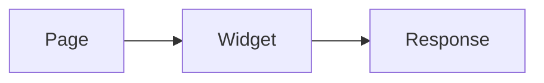

## Install

This guide installs the widget. It is a real page with prose, code, diagrams, media, a form, and
trust evidence; nothing on it is a mock.

:::callout{type=warning title="Back up first"}
A warning callout with a title.
:::

```ts
export const answer = 42;
```

:::code-tabs{labels='["npm","pnpm"]'}
```bash
npm install @example/widget
```

```bash
pnpm add @example/widget
```
:::

:::tabs{group="integration-install"}
### macOS

```bash
brew install widget
```

### Linux

```bash
curl -fsSL https://get.example.com | sh
```
:::

:::details{summary="A closed disclosure"}
The body of a disclosure that starts closed.
:::

:::steps
1. Install the widget.
2. Run the checks.
3. Read the output.
:::

:::terminal
$ widget check
ok 3 - the examples pass
:::



::video{src="https://www.youtube.com/watch?v=aqz-KE-bpKQ" title="Widget walkthrough" poster="/poster.svg"}

::embed{src="https://www.youtube.com/watch?v=aqz-KE-bpKQ" title="Widget walkthrough embed"}

## Configure

::variables-form{id="integration-variables" variables='[{"name":"api_key","default":"YOUR_KEY","type":"string"},{"name":"host","default":"https://api.example.com","type":"url"}]'}

```bash
curl -H "Authorization: Bearer {{api_key}}" {{host}}/v1/status
```

:::output-block{deps='["project"]' stream=stdout exit=0 duration=340ms}
Finished {{project}} in 340 ms
:::

:::endpoint{method=get path="/widgets/{id}" parameters='[{"name":"id","type":"uuid","required":true,"description":"The widget id."}]'}
Returns one widget.

### Response

```json
{ "id": "w_123", "name": "Ada" }
```
:::

::schema-table{data="widget" label="Widget options"}

:::version-badge{version=0.2.0 variant=changed block}
:::

:::version-diff{from="v1" to="v2" changes='[{"kind":"added","title":"Retries"},{"kind":"removed","title":"Legacy flags"},{"kind":"changed","title":"Install"},{"kind":"moved","title":"Upgrade","from":"3","to":"5"}]'}
:::

::tested-chip{passed=3 failed=0 total=3 lastPassed=2026-03-04}
:::

Press :kbd[Ctrl+K] to search. The source of this page is `guide/install.md`.
