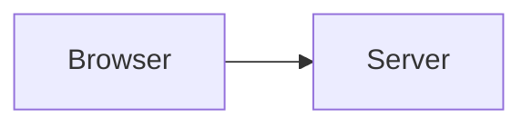
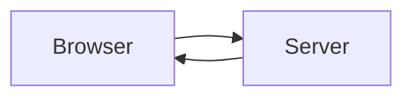

A `mermaid` fence becomes an inline SVG when the site is built. The browser never loads Mermaid: the diagram is already a picture, so it works without JavaScript, prints, and reads as text to an agent. The source stays on the page in a disclosure block, so a reader can copy it or an agent can edit it.

## Syntax

A fenced code block tagged `mermaid`:

```markdown

```

The optional `alt="…"` in the fence meta is the diagram's text alternative. Without it, a leading `%% alt: …` comment in the diagram source is used.

## Options

| Name | Type | Default | What it does |
| --- | --- | --- | --- |
| `alt` | string | the `%% alt:` comment, else empty | The accessible name and `<title>` of the SVG. Put it in the fence meta or as a leading `%% alt: …` comment. |

There are no other options. The fence body is the Mermaid source, and the diagram keeps the block's `data-src` and full source span like every other block.

## Example



A sequence diagram works the same way:

```mermaid alt="The browser asks the server for a page, and the server answers"
sequenceDiagram
  participant B as Browser
  participant S as Server
  B->>S: GET /guide/
  S-->>B: 200 OK
```

## Notes

- The diagram is rendered during the build in a short child process, so a complex diagram adds build time but no page weight.
- Colors come from the theme tokens, so the diagram follows light, dark, and right-to-left pages.
- When a diagram cannot be rendered, the page keeps the source and shows a short fallback instead of failing the build. The fallback sentence and the "Diagram source" summary are read from `i18n/*.json` in the page's language.
- The source disclosure keeps the exact Mermaid text for agents; the Markdown twin and `llms-full.txt` carry the same source.

## Build cache

Rendering is deduplicated within one build process. To reuse renders between builds, opt in with a cache directory:

```bash
LATEEN_MERMAID_CACHE_DIR=.cache/mermaid npx mizzen build . --out dist
```

An entry is addressed by the normalized source, the render options, and the cache-format version, so a change to any of them misses only that entry. Entries are written to a temporary file and renamed into place, so a reader sees a whole entry or none. A missing, partial, oversized, or unreadable entry is rendered normally and never reaches the page; only successful renders are stored, so a diagram that failed once is retried by the next build.

The cache is only a saving. Leaving `LATEEN_MERMAID_CACHE_DIR` unset (the default), using a read-only directory, or a write failure keeps the current build behavior.

Delete the directory to clear the cache, for example after changing the Mermaid version or the renderer:

```bash
rm -rf .cache/mermaid
```
